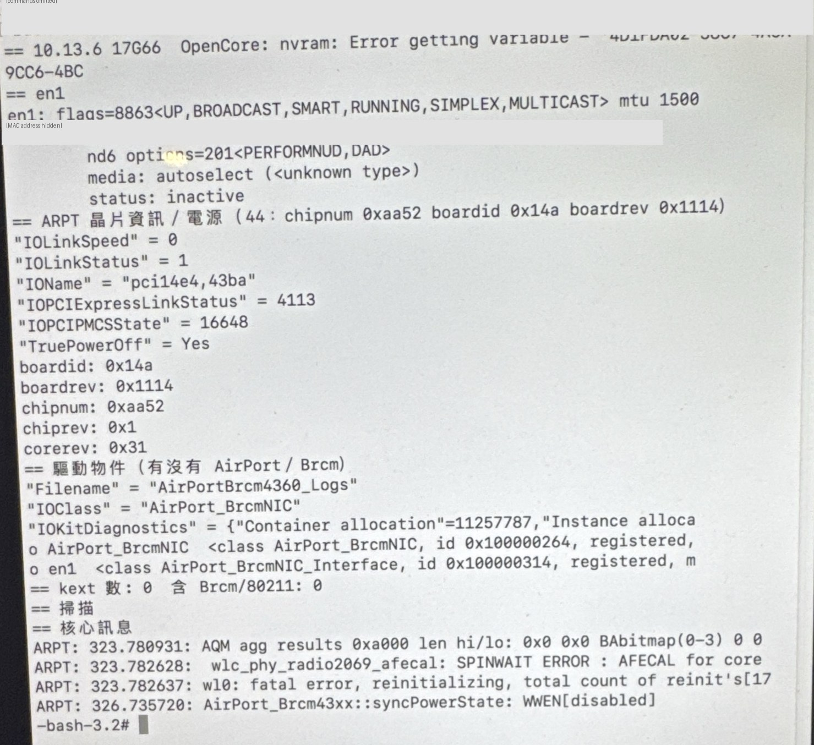

# Broadcom Wi-Fi on iMac17,1: one machine works, the identical one does not (in progress)

[繁體中文](../zh-TW/05-tahoe-wifi.md) · [Home](../../README.md)

Two iMac17,1 (2015, 5K) machines carry the same Broadcom card (`pci14e4,43ba`, subsystem `106b:14a`, BCM43602) and run the **byte-identical** OpenCore 1.0.9 EFI and the same OCLP 3.0.0-rc.3 root patch on macOS Tahoe 26.7.1. **Machine B** powers its Wi-Fi on, scans and joins a network. **Machine A** reports `Off (forced)` and `APPLE80211_IOC_POWER` return `-1`. This page records what was tried, what was ruled out, and what is still open. Status: 18 October 2026. **Tested** means observed on the named machine; **inference** is marked.

## What the failing machine does

Reconstructed from the unified log, which an administrator can read without root (see [Reproduce the timeline](#reproduce-the-timeline)). Times are seconds after boot and were identical across more than five boots:

| Time | Event on machine A |
| --- | --- |
| T+10 s | `ARPT` goes D0 → D3 → D0 once (`setPCIPowerState(OFF)`, then `(ON)`). This one succeeds. |
| **T+20 s** | `ARPT` goes to D3 again. **No `setPCIPowerState(ON)` follows for the rest of the boot.** |
| T+24 to T+35 s | The kernel repeats `nub ARPT is not powered, retrying matching in 100ms` 87 to 101 times, then stops. The node gains `IOPCIDevicePublishRetryTimeout = Yes`. |
| T+25 s | `airportd` asks for power: `APPLE80211_IOC_POWER` returns `-1`. `networksetup -getairportpower en1` shows `Off (forced)`. |

In IORegistry the card's driver object exists and is `matched, active`, but the chip fields the driver normally reads (`chipnum`, `chiprev`, `corerev`, `boardid`, `boardrev`) are missing, `IOLinkSpeed` is `0`, and `TruePowerOff = Yes`. The PCIe link itself trained (x1, 2.5 GT/s).

## What the working machine does

Machine B shows none of the power events above, no `IOC_POWER` failure, `Wi-Fi Power: On`, `status: active` (it joined a 5 GHz network), a CoreWLAN scan result, and the chip fields: `chipnum 0xaa52` (BCM43602), `chiprev 1`, `corerev 0x31`, `boardid 0x14a`, `boardrev 0x1114`, `IOLinkSpeed 11000000`. It stayed working after an account restore and a user login.

## Identity checks (all identical on both machines)

- PCI: vendor `14e4`, device `43ba`, **revision `01`**, subsystem `106b:14a`, class `028000`, the same ACPI path (`_SB/PCI0/RP01/ARPT`), the same BAR layout, and the same Intel root port (`8086:a110`, revision `f1`) with the same link capabilities.
- Loaded kexts: `IOSkywalkFamily 1.0`, `IO80211FamilyLegacy 1200.12.2b1`, `AirPort.BrcmNIC 1400.1.1`, with the same UUIDs.
- Files the OCLP Modern Wireless patch puts on the system volume (`wifip2pd`, the `IO80211` and `WiFiPeerToPeer` frameworks and their `Old` libraries): same SHA-256.
- Boot and System kernel collections: same SHA-256. The Auxiliary collection differs, as expected for a per-machine build; its listed extensions and UUIDs match and it contains no Wi-Fi driver.
- OCLP patch record: identical line for line apart from the timestamp.
- EFI: machine A's internal EFI is byte-for-byte identical (175 files) to the EFI that works on machine B.

**The chip and board fields** (`chipnum`, `chiprev`, `corerev`, `boardid`, `boardrev`) cannot be read under Tahoe on machine A because the driver does not get that far. They could be read under the native High Sierra installer and are **identical to machine B's**, so the two cards are the same model and revision.

## Experiments on the failing machine

| Experiment | Result |
| --- | --- |
| Change only `DisableIoMapper=true` (external EFI) | Kernel panic: `IONVMeController::CommandTimeout`, `nvme: Controller fatal bit set`, `Still waiting for root device`. Its third-party internal NVMe sits under an AppleVTD device mapper, so global IOMapper changes are unsafe here. **This does not show that AppleVTD causes the Wi-Fi failure.** |
| Copy of the working EFI with Lilu 1.7.2 | Boots; Lilu 1.7.2 loads; Wi-Fi unchanged. |
| Same EFI plus [BroadcomVTD-Tahoe](https://github.com/kgp-macPro/BroadcomVTD-Tahoe) v0.2.17 | Boots; plugin loads; status changes from `Off (forced)` to plain `Off`, and System Information lists the card firmware and channels. Power on still fails. Whether the plugin entered its corrective mode is **unknown**: its trace is an opaque sysctl (`debug.broadcomvtd`) that `sysctl -a` does not list and that has not been captured. |
| Rebuild the network configuration (move aside `NetworkInterfaces.plist`, `preferences.plist`, the airport preferences, the `networkextension` files and the known-networks list, then reboot), done twice | After the first rebuild the card powered on and scanned for roughly the first minute after boot, then went to D3 and could not be powered on again. The second rebuild (including the wired settings) behaved like the original failure. |
| SMC reset (power cord out for 30 s) | No change. |
| Disconnect every Thunderbolt device and reboot | No change; no Thunderbolt device was enumerated in that boot. |
| Boot from the internal EFI instead of the external one | No change. |
| Boot Sequoia 15.8.1 on the same machine | **Also fails.** Every Sequoia boot recorded in the log since 07:44 that day shows the same `IOC_POWER -1` about 25 s after boot, and the chip fields are empty. The owner also reports that this machine's Wi-Fi was already intermittent (sometimes working, sometimes not) in everyday use before this investigation, which at the time was put down to incomplete drivers. |
| Boot the macOS High Sierra 10.13 (build 17G66) installer natively (no OpenCore: the OpenCore NVRAM variable does not exist) and read the card state | The native `AirPort_BrcmNIC` driver **does read the chip**: `chipnum 0xaa52`, `chiprev 0x1`, `corerev 0x31`, `boardid 0x14a`, `boardrev 0x1114`, identical to machine B. But the kernel log shows the radio failing its calibration and the firmware crashing and restarting repeatedly: `wlc_phy_radio2069_afecal: SPINWAIT ERROR : AFECAL for core`, `wl0: fatal error, reinitializing, total count of reinit's[17`, `syncPowerState: WWEN[disabled]`. `TruePowerOff = Yes`, no scan result. |

### Native High Sierra: the card state

A photo of the terminal in the High Sierra installer, booted without OpenCore. The first line shows the OpenCore NVRAM variable missing; the chip and board fields are readable; the kernel log shows `AFECAL ... SPINWAIT ERROR` and `reinit's[17`. (Command lines and the MAC address are masked.)



## Interpretation (inference)

- The OCLP-injected driver, the root-patched files, the kernel collections and the EFI are all identical on the working machine, and the failure repeats under three operating systems, so it is not specific to Tahoe or to the OCLP wireless patch set.
- The failure sequence looks like a power-management event the card cannot recover from: the driver object is created but never finishes initialising before the power policy puts the card into D3, after which it does not come back.
- **Working explanation: a faulty Wi-Fi card on machine A.** Under the native High Sierra installer, with no OpenCore, no OCLP kext and no root patch, the stock driver finds the chip but the radio's analog front-end calibration fails (`AFECAL ... SPINWAIT ERROR`) and the firmware keeps crashing and restarting (`total count of reinit's[17`). That is independent of macOS version, EFI, drivers and patches, and it matches the owner's report that this machine's Wi-Fi had been intermittent long before any of these experiments. An unseated connector or a power-delivery fault on the board cannot be excluded without opening the machine.
- The wired network on the same machine is unaffected, and so is Bluetooth: the owner uses an Apple Magic Mouse over Bluetooth on machine A. On this combo card Bluetooth is a separate USB function, which fits a fault confined to the Wi-Fi half.

## Reproduce the timeline

No root is needed for an administrator account. Replace the start time with the machine's boot time:

```sh
log show --start "YYYY-MM-DD HH:MM:SS" --style compact --predicate \
  '(process == "kernel" AND eventMessage CONTAINS "ARPT" AND (eventMessage CONTAINS "PowerState(OFF)" OR eventMessage CONTAINS "PowerState(ON)")) \
   OR (process == "kernel" AND eventMessage CONTAINS "nub ARPT is not powered") \
   OR (process == "airportd" AND eventMessage CONTAINS "type 19/")'
```

When reading `kern.boottime`, take the `sec` field, not `usec`; a greedy regular expression returns the microseconds.

## Open questions

1. Has anyone seen `wlc_phy_radio2069_afecal: SPINWAIT ERROR` and repeated firmware reinitialisation on a BCM43602 in an iMac17,1, and was replacing or reseating the card the fix?
2. Is there a way to see which client requested the power-down? The log shows only the executor (`IOPCIDevice::setPCIPowerState`), not the requester.
3. If the card or its connector is at fault, has a power cycle of the card (not just the SMC) or reseating it helped anyone? Opening a 5K iMac is a last resort here; the next software-free check is the native High Sierra boot listed above.
