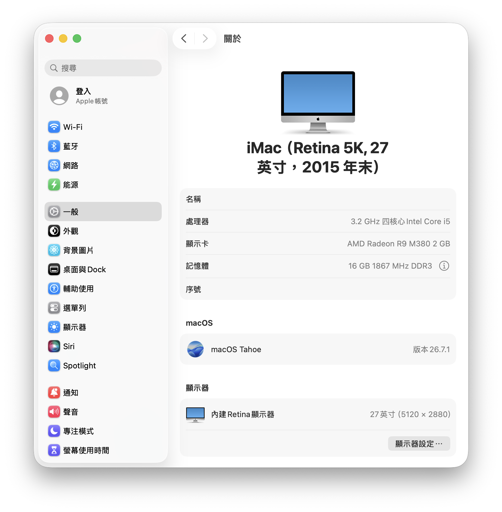
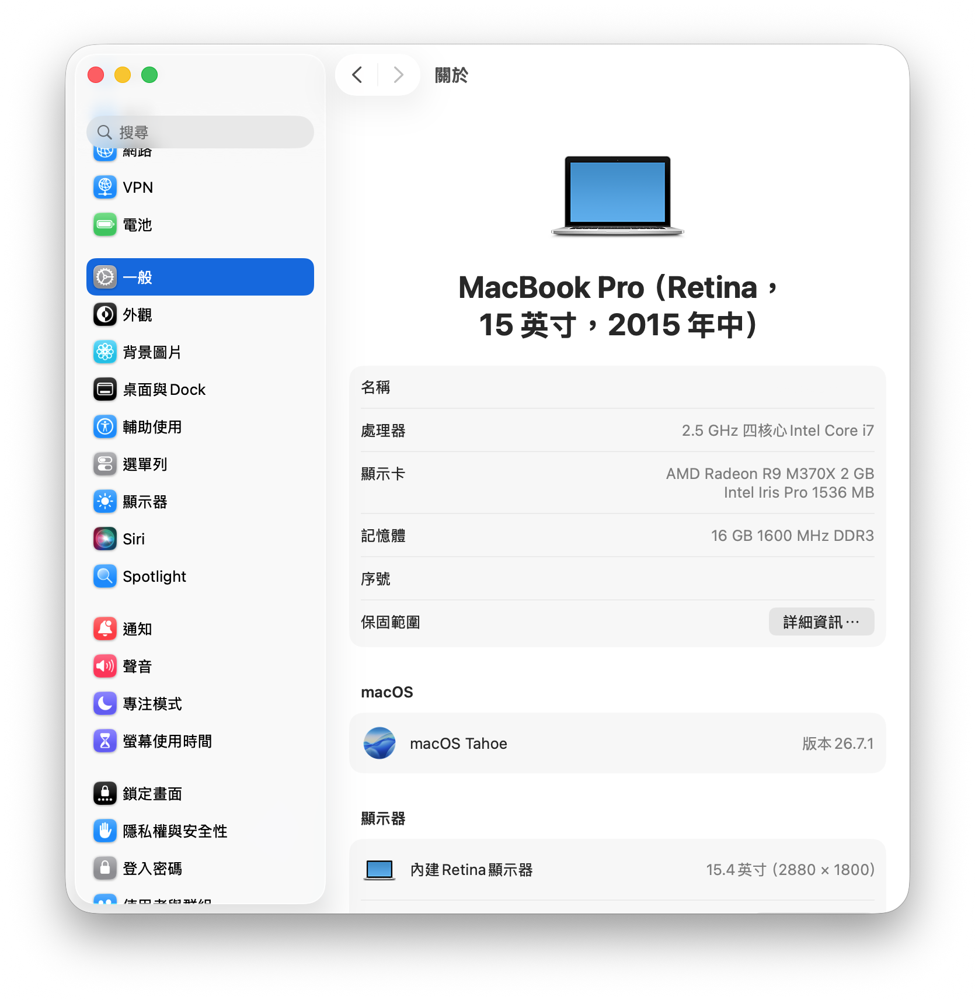
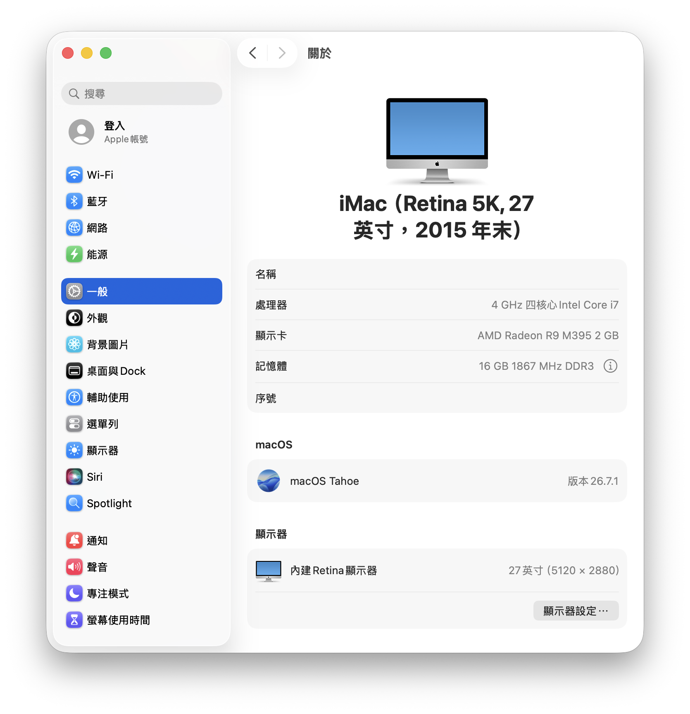
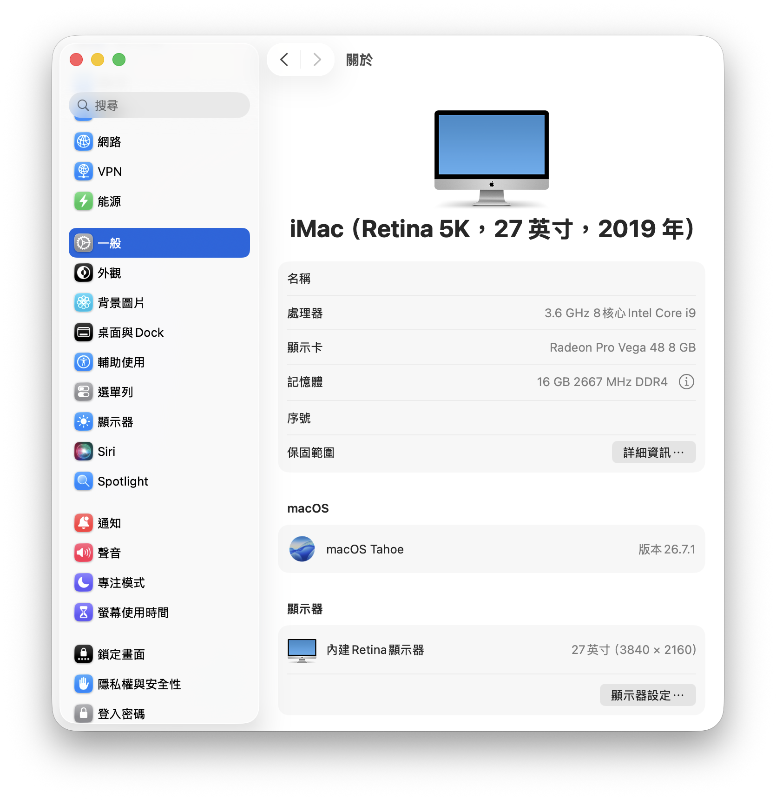

# 機型與結果

[English](../en/01-machines-and-results.md) · [首頁](../../README.zh-TW.md)

除非另有註明，下列觀察來自 2026 年 10 月的 macOS Tahoe 26.7.1（25G241）。表中的 OCLP 版本是當時實驗所用版本，不代表後續版本也已驗證。OCLP 3.0.0-rc.3 是[預覽版](https://github.com/dortania/OpenCore-Legacy-Patcher/releases/tag/3.0.0-rc.3)。

| 機型 | GPU／OCLP 與 OpenCore | 實測 | 未解或未驗證 |
| --- | --- | --- | --- |
| MacBookPro11,5，2015 15 吋 | Radeon R9 M370X；OCLP 3.0.0-rc.3 | Tahoe 在圖形 root patch 後開機；先還原補丁再執行遷移輔助程式，轉移完成 | 帶補丁遷移會反覆重開；未逐一檢查所有 App 與服務 |
| iMac17,1 #1，2015 5K | Radeon R9 M395；OCLP 3.0.0-rc.3 建置，後換 OpenCore 1.0.9 | Tahoe 有圖形加速及實體 5K；手動帳號還原 v2.1 完成，登入已驗 | Broadcom Wi-Fi 仍為 `Off (forced)`；此 5K 配置尚無成功的遷移輔助程式路線 |
| iMac17,1 #2，2015 5K | Radeon R9 M380（i5-6500）；與 #1 相同的 OCLP 3.0.0-rc.3＋OpenCore 1.0.9 EFI | 乾淨安裝 Tahoe 並自動套用 root patch；實體 5K（`IOFBCurrentPixelCount` 15,639,360）；Wi-Fi 可上電並掃描；手動還原 v3 完成帳號還原 | Command Line Tools 不在還原範圍，要另外安裝 |
| iMac19,1，2019 5K | Radeon Pro Vega 48；OCLP 3.0.0，後換 OpenCore 1.0.9 | Tahoe 可開機，原生圖形及 Wi-Fi 可用；Modern Audio root patch 恢復內建喇叭輸出 | 診斷開機繞路在 verbose 輸出前卡住；可開機路徑只有實體 4K，5K 未解 |

**實測：**iMac19,1 的 Vega GPU 不需圖形 root patch，但音效需要。當時 OCLP 的機型資料仍將此機視為最新系統原生支援，因此沒有自動放寬 SIP，也沒有為音效補丁加入 AMFIPass。當次 EFI 因而另行調整，且 OCLP 重建後必須重做。這是特定配置的觀察，並非通用的 OCLP 操作規範。[OCLP 機型資料](https://github.com/dortania/OpenCore-Legacy-Patcher/blob/main/opencore_legacy_patcher/datasets/smbios_data.py)。

**證據界線：**本文的「5K」指實際 framebuffer 輸出，不是縮放介面的標籤。詳見[顯示量測](02-5k-imac-display.md)、[遷移](03-migration-assistant.md)、[還原](04-restore-without-migration-assistant.md)與 [Wi-Fi](05-tahoe-wifi.md)。

## 畫面截圖

macOS Tahoe 26.7.1（25G241）的「系統設定 → 一般 → 關於」，2026 年 10 月。圖中的裝置名稱與序號欄位是空白的。

*iMac17,1 #2：Core i5、Radeon R9 M380 2 GB、macOS Tahoe 26.7.1。*

*MacBookPro11,5：Core i7、Radeon R9 M370X 2 GB 加 Intel Iris Pro、macOS Tahoe 26.7.1。*

*iMac17,1 #1：Core i7、Radeon R9 M395 2 GB、macOS Tahoe 26.7.1。*

*iMac19,1：Core i9、Radeon Pro Vega 48 8 GB、macOS Tahoe 26.7.1。這台的顯示器那一行已經寫成 3840 × 2160，與[顯示器筆記](02-5k-imac-display.md)量到的 4K 輸出一致。*

**注意：**「關於本機」的顯示器那一行是面板規格，不是實際送出的訊號。5K iMac 要確認實際輸出，請用[顯示器筆記](02-5k-imac-display.md)裡的 IORegistry 量測。
