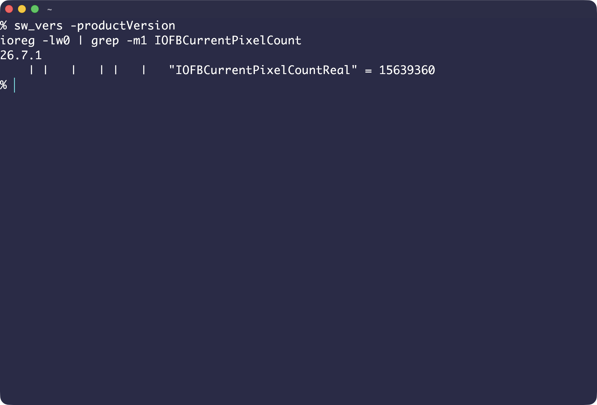
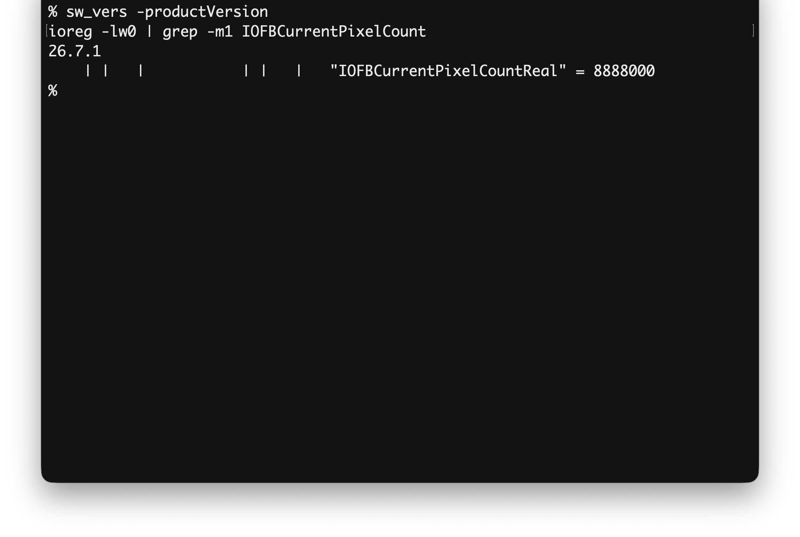

# 5K iMac 顯示路徑

[English](../en/02-5k-imac-display.md) · [首頁](../../README.zh-TW.md)

**實測：**OCLP 的雙 DisplayPort 繞路，經 Apple Diagnostics 啟動器進入 OpenCore，並把啟動器放在 `.diagnostics/Drivers/HardwareDrivers/Product.efi`。目的是保留韌體的雙串流 5K 模式。此機制最初在另一代 iMac 上展示，不能假定每款機型都能用。[原作者研究](https://khronokernel.github.io/macos/2021/12/08/5K-UEFI.html)、[OCLP 實作](https://github.com/dortania/OpenCore-Legacy-Patcher/blob/main/opencore_legacy_patcher/efi_builder/firmware.py)、[OCLP PR #777](https://github.com/dortania/OpenCore-Legacy-Patcher/pull/777)。

在 **iMac19,1**，OpenCore 選單可呈現 5K，但選 Sequoia、安全模式或 Tahoe 安裝程式後，皆在開機交棒後停止，連 `-v` 文字都沒有。移除診斷繞路、改走一般的 `LauncherPath=Default`，Tahoe 可以開機，實體輸出卻只剩 4K。紀錄中的 OpenCore 1.0.9、`TextRenderer=SystemGraphics` 與 `DirectGopRendering=true` 都未解決卡住問題。**推論：**故障與這條路徑有關；真正停在哪條指令尚未知。DEBUG 最後一行不能當成停住位置的證明。

在 **iMac17,1 #1**，使用診斷繞路的 OCLP 3.0 EFI，Sequoia 與 Tahoe 都以實體 5K 開機。這排除「OCLP 3.0 的 APFS 驅動變更必然導致卡住」的說法，但仍無法找出 iMac19,1 的原因。改用 `Fan.efi` 等其他 Diagnostics 模組只是**未測構想**，不是解法。

## 量測實際輸出

**實測：**iMac19,1 實際走 4K 路徑時，`system_profiler SPDisplaysDataType` 仍可能顯示 Retina 5K 面板或 5120 × 2880。請在同一次開機檢查 IORegistry 的 `IOFBCurrentPixelCount`：

```sh
ioreg -lw0 | grep IOFBCurrentPixelCount
```

紀錄中的 5K 路徑為 **15,639,360** 像素（5280 × 2962 framebuffer），4K 路徑為 **8,888,000**（4000 × 2222）。framebuffer 計數含時序或填充像素，並非面板標示的有效解析度；應與顯示模式、framebuffer 拓樸及已知可用的開機結果交叉比對。縮放後的「看起來像」解析度不足以證明實體 5K。

兩台 iMac17,1 使用 OCLP 3.0 的 EFI（含診斷繞路）時，這個檢查讀到的是 **15,639,360**（5K）：


*iMac17,1 #1，macOS 26.7.1：`IOFBCurrentPixelCountReal = 15639360`。*



*iMac17,1 #2，macOS 26.7.1：`IOFBCurrentPixelCountReal = 15639360`。*

在 iMac19,1 使用可開機的路徑（沒有診斷繞路）時，同一個檢查的結果是 **8,888,000**，也就是 4K 的數值：



*iMac19,1，macOS 26.7.1：`IOFBCurrentPixelCountReal = 8888000`（4K）。同一版 OCLP 下，iMac17,1 的兩台讀到的是 15639360（5K）。*

**未解：**目前沒有在 iMac19,1 上同時能開 Tahoe 並保留實體 5K 的實測路徑。實驗時保留可開機 EFI，每次只改一項。
